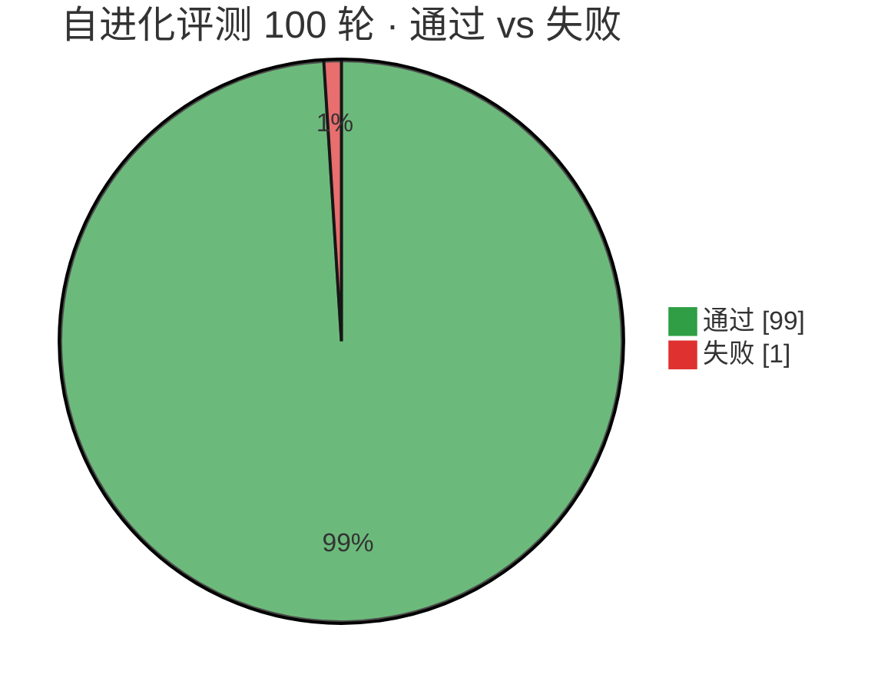
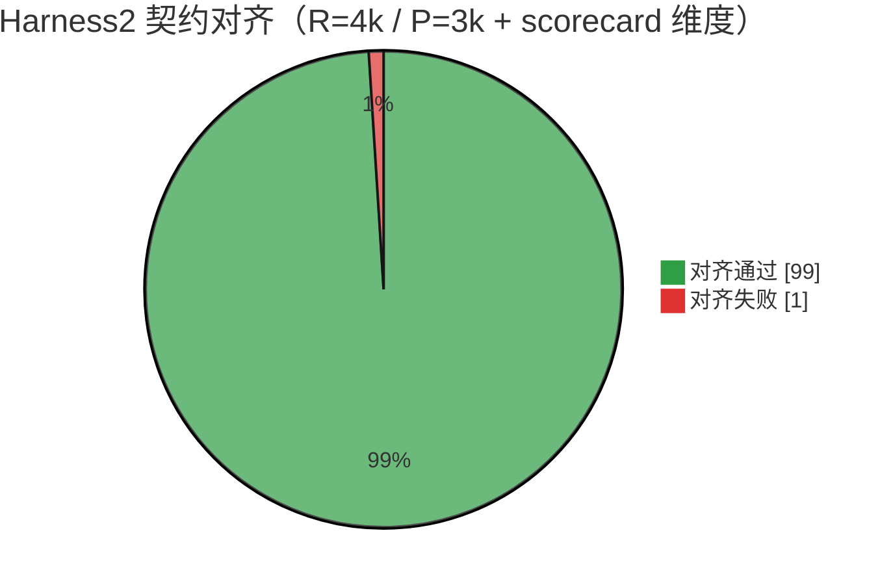
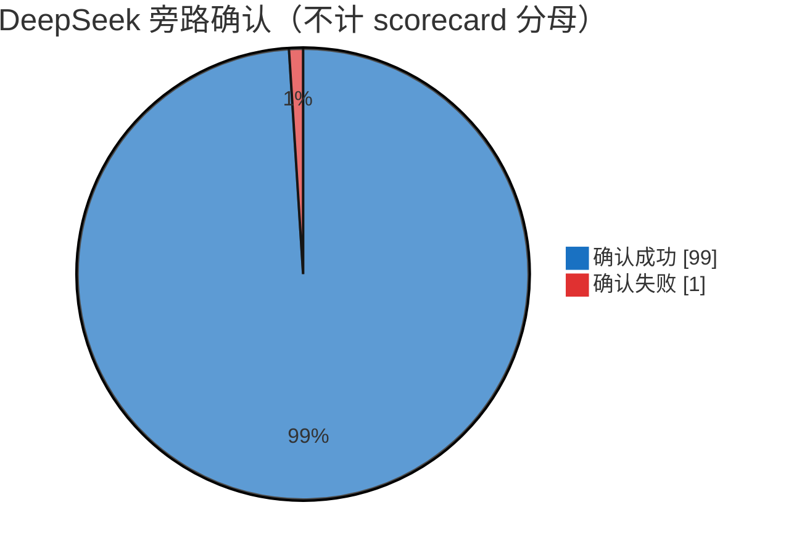
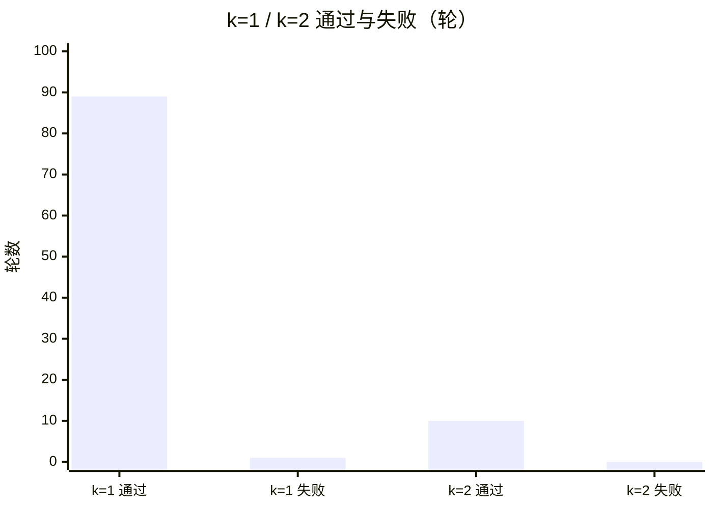

# Metamorph 自进化评测打分

| 项 | 值 |
|---|---|
| 总评 | **PASS** |
| 综合分 | **100.0** / 100 |
| 维度数 | 9 |

## 维度明细

| ID | 维度 | 通过 | 得分 | 细节 |
|----|------|------|------|------|
| `base_fails` | 基座 harness 不及格（存在进化空间） | ✅ | 100.0 | n_passed=0 |
| `sweep_complete` | 域 sweep 全部完成 | ✅ | 100.0 | done=2 failed=0 |
| `budget_identity` | 预算身份 R=4k / P=3k | ✅ | 100.0 | agg:R=4,P=3 seq:R=4,P=3 |
| `evolved_passes` | 进化后 selection 通过准则 | ✅ | 100.0 | agg:n_passed=1 seq:n_passed=1 |
| `self_evolution_lift` | 自进化增益（基座失败 → 进化成功） | ✅ | 100.0 | base 0 → evolved pass |
| `library_retention` | Library 保留跨任务材料 | ✅ | 100.0 | files=2 |
| `judge_report` | Judge→Report 均分 ≥ 99% | ✅ | 100.0 | mean=100.00% modes=2 |
| `dual_modes` | agg 与 seq 双模式均有 graded 行 | ✅ | 100.0 | summaries=2 |
| `noise_floor_k1` | k=1 时 agg/seq 分差为噪声地板（≤1pt） | ✅ | 100.0 | gap=0.00 (agg=100.00 seq=100.00) |

## Report 汇总（mode×k）

```
demo-oc eval
========================================
  parallel k=1: n=  2 | score 100.00% | picked output: final 2 / candidate 0 / base 0
  sequential k=1: n=  2 | score 100.00% | picked output: final 2 / candidate 0 / base 0

  NOTE  at k=1 the parallel and sequential modes are the same procedure (one INVARIANT draw, one DOMAIN draw, one composition).
        The 0.00 pt between them is therefore a NOISE FLOOR, not a result -- an effect at k>=2 has to clear it.
```

## 口径说明

- 评测流水线：Propose–Probe–Compose → Selection → Judge → Report。
- 预算身份：R=4k、P=3k；mode 含 parallel（agg）与 sequential（seq）。
- 自进化判据：基座不及格，且进化后 selection 通过同一准则。
- k=1 时 agg/seq 同分差视为噪声地板；k≥2 的效应须越过该地板。
- 本报告由离线 Demo 确定性跑出，无需 API Key。

## Harness2 对齐 · 100 轮自进化战役

对齐 Harness2（`demo.py` / `recursion.py` / `tests/test_workflow.py` / `docs/EXPERIMENTS.md`）的方法与数据，在 Metamorph 上强制跑满 **100** 轮 `metamorph eval`（DeepSeek 旁路确认）。起止：2026-11-14 09:13:57 → 09:29:11 (+08:00)。

### 总览







### 按预算倍数 k 分拆



| 子集 | 通过 | 失败 |
|------|------|------|
| `k=1`（90 轮） | 89 | 1（第 **42** 轮） |
| `k=2`（10 轮） | 10 | 0 |
| **合计** | **99** | **1** |

### 方法与数据（契约）

| 项 | 内容 |
|---|---|
| 任务 | `ledger-1`、`ledger-2`（accounting） |
| 账本 | ledger-1: `100.25 / -20.10 / 5.00` → 期望 `Total: 85.15`；ledger-2: `35.50 / -10.25 / -5.00` → `Total: 20.25` |
| 模式 | parallel（agg）+ sequential（seq） |
| 预算身份 | `R=4k`、`P=3k` |
| 流水线 | Propose–Probe–Compose → Selection → Judge → Report |
| 自进化 | 基座失败 → 进化后 selection 通过；Library 保留跨任务材料 |
| 日程 | 默认 `k=1`；每第 10 轮 `k=2` 清障（10, 20, …, 100） |

第 42 轮为瞬时 CLI/解析失败（`score=null`），非契约维度系统性回归；后续轮次（含全部 `k=2`）均 PASS。本地原始轮次日志在 `runs/h2evo100/`（已 gitignore）。

## 重新生成

```bash
mvn -q exec:java -Dexec.mainClass=com.metamorph.cli.MetamorphMain \
  -Dexec.args="eval --output runs/eval --k 1 --report docs/EVAL.md --json docs/eval-scorecard.json"
```
