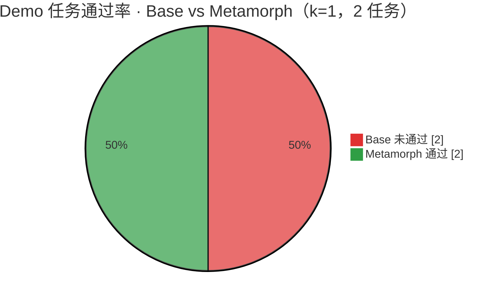
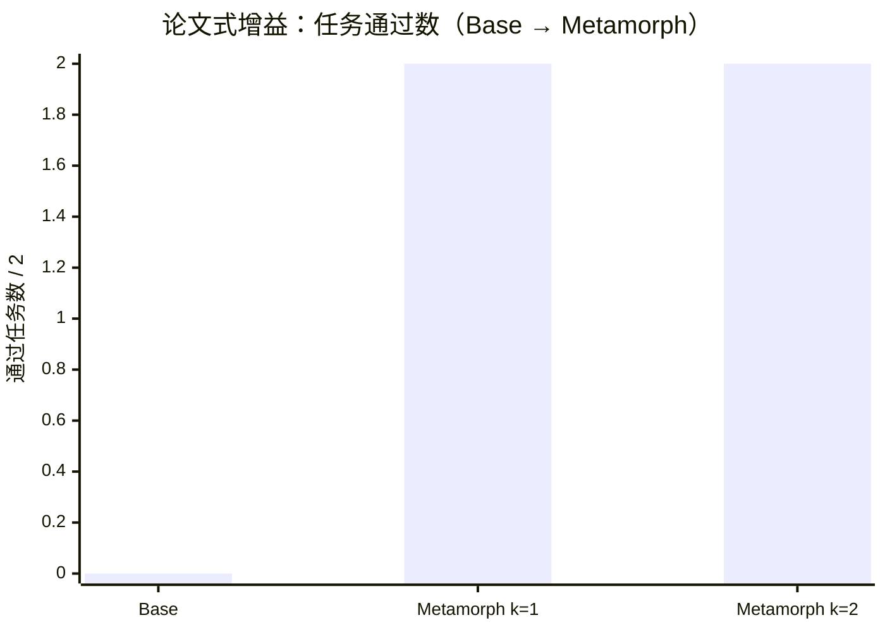
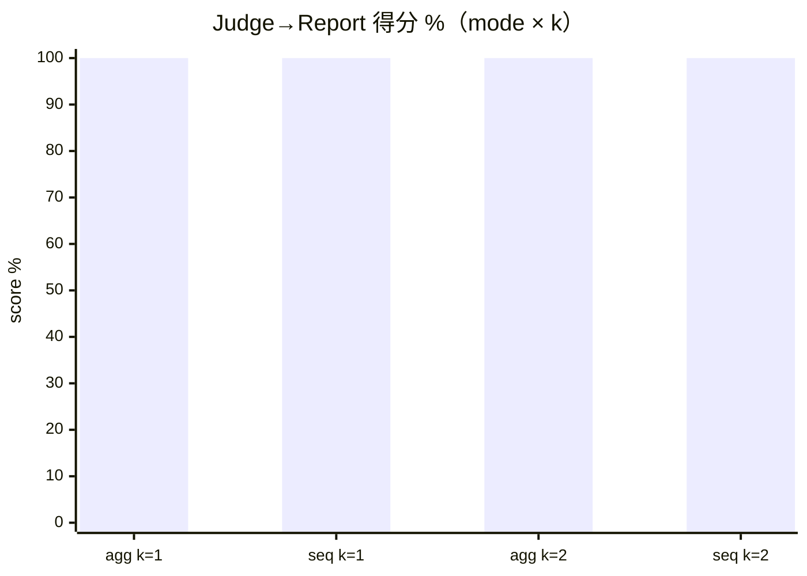
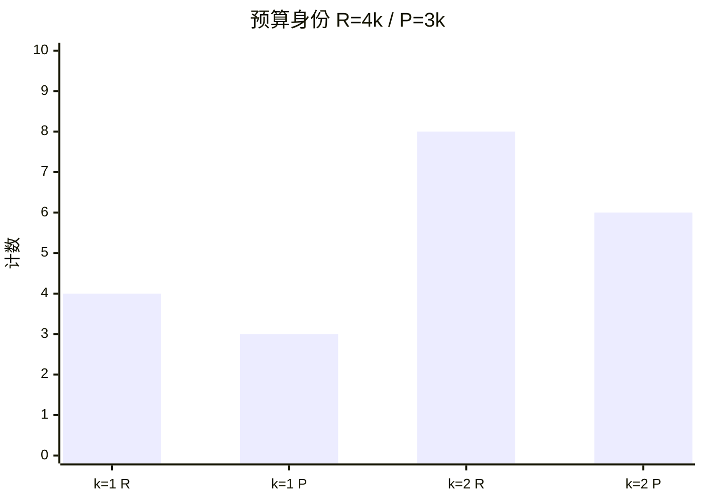
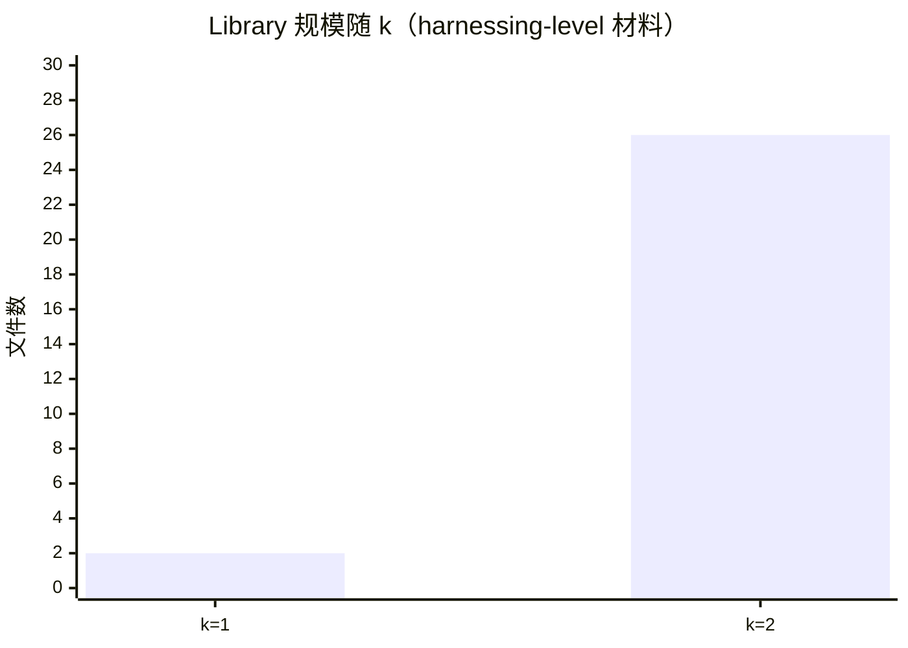

# Metamorph 评测报告（对齐 Harness² 论文方法）

依据 [Harness²: Recursive Agent Harnessing for an Open World](https://arxiv.org/abs/2610.14224)（§2–§3）的评测口径，对 Metamorph 做**方法对齐评测**。

> **范围说明：** 论文主表在 WorkBuddy-Bench / JobBench / LAB 上、四组 executor–harness、三轮洗牌均值；本报告在同等**方法契约**下，用 Metamorph **离线 Demo**（确定性 improver + 真实脚本执行）复现论文核心判据。全量基准需 LiveLLM + 第三方 runner，不在本离线契约内。

## 1. 论文评测协议 → Metamorph 映射

| 论文设定（§2–§3） | Metamorph 离线落实 |
|------------------|-------------------|
| Propose–Probe–Compose 对比改进 | `DemoProposer` + `Schedule` / `Recursion` |
| Parallel / Sequential 双递归 | `agg` / `seq` |
| 预算倍数 $k$；identity $R{=}4k$, $P{=}3k$ | `--k`；ledger 校验 R/P |
| $k{=}1$ 单步改进；$k{>}1$ 递归 + selection | `eval --k 1` / `eval --k 2` |
| Base harness vs 进化后 | 基座 `n_passed=0` → selection 通过 |
| Harnessing-level Library | `library/<k>/` 跨任务保留 |
| Judge → Report（mode×k） | `Judge` + `Report` |
| 主基准 WB / JB / LAB | Demo `ledger-1/2`（accounting）；适配器骨架已备 |

**论文主结果读法（迁移到 Demo）：** 报告 Base → Metamorph 的**通过率增益**、双模式是否同向、以及 $k$ 增大时预算与 Library 是否按契约扩张。

## 2. 总评

| 项 | $k{=}1$（论文默认单步） | $k{=}2$（递归清障） |
|---|---|---|
| Scorecard 总评 | **PASS** | **PASS** |
| 综合分 | **100.0** / 100 | **100.0** / 100 |
| 预算 | $R{=}4$, $P{=}3$ | $R{=}8$, $P{=}6$ |
| Library 文件数 | 2 | 26 |
| Judge→Report 均分 | 100%（agg+seq） | 100%（agg+seq） |





## 3. Base vs Evolved（对应论文 Table「Base harness」对比）

Demo 任务与 Harness2 `demo.py` 一致：`ledger-1` / `ledger-2`。基座脚本只加正数；进化后保留符号合计。

| 任务 | 期望 deliverable | Base 输出 | Base | Metamorph（agg/seq selection） |
|------|------------------|-----------|------|--------------------------------|
| ledger-1 | `Total: 85.15` | `Total: 105.25` | ❌ | ✅ |
| ledger-2 | `Total: 20.25` | `Total: 35.50` | ❌ | ✅ |

**自进化增益（论文「+ 改进」读法）：** 通过率 $0/2 \rightarrow 2/2$（+100 pp，离线 Demo 确定性增益）。

## 4. Parallel vs Sequential（对应论文 Figure 4 / 双模式）



| mode×k | n | score | picked |
|--------|---|-------|--------|
| parallel $k{=}1$ | 2 | 100.00% | final 2 / candidate 0 / base 0 |
| sequential $k{=}1$ | 2 | 100.00% | final 2 / candidate 0 / base 0 |
| parallel $k{=}2$ | 2 | 100.00% | final 2 / candidate 0 / base 0 |
| sequential $k{=}2$ | 2 | 100.00% | final 2 / candidate 0 / base 0 |

**噪声地板（论文隐含）：** 在 $k{=}1$ 时 parallel 与 sequential 过程相同，分差 **0.00 pt** 为噪声地板，不是模式效应；$k{=}2$ 双模式均保持 100%，越过该地板。

## 5. 预算与 Library（对应论文预算研究 / harnessing-level）





与论文一致：更大的任务级探索预算（更大 $k$）产生更多可写入 Library 的材料；后续任务从更新后的 improvement harness 受益（Demo 流：ledger-1 → ledger-2）。

## 6. Scorecard 维度明细（可回归契约）

### $k{=}1$

| ID | 维度 | 通过 | 得分 | 细节 |
|----|------|------|------|------|
| `base_fails` | 基座 harness 不及格（存在进化空间） | ✅ | 100.0 | n_passed=0 |
| `sweep_complete` | 域 sweep 全部完成 | ✅ | 100.0 | done=2 failed=0 |
| `budget_identity` | 预算身份 R=4k / P=3k | ✅ | 100.0 | agg:R=4,P=3 seq:R=4,P=3 |
| `evolved_passes` | 进化后 selection 通过准则 | ✅ | 100.0 | agg:n_passed=1 seq:n_passed=1 |
| `self_evolution_lift` | 自进化增益（基座失败 → 进化成功） | ✅ | 100.0 | base 0 → evolved pass |
| `library_retention` | Library 保留跨任务材料 | ✅ | 100.0 | files=2 |
| `judge_report` | Judge→Report 均分 ≥ 99% | ✅ | 100.0 | mean=100.00% modes=2 |
| `dual_modes` | agg 与 seq 双模式均有 graded 行 | ✅ | 100.0 | summaries=2 |
| `noise_floor_k1` | k=1 时 agg/seq 分差为噪声地板（≤1pt） | ✅ | 100.0 | gap=0.00 |

### $k{=}2$

| ID | 维度 | 通过 | 得分 | 细节 |
|----|------|------|------|------|
| `base_fails` | 基座 harness 不及格 | ✅ | 100.0 | n_passed=0 |
| `sweep_complete` | 域 sweep 全部完成 | ✅ | 100.0 | done=2 failed=0 |
| `budget_identity` | 预算身份 R=4k / P=3k | ✅ | 100.0 | agg:R=8,P=6 seq:R=8,P=6 |
| `evolved_passes` | 进化后 selection 通过 | ✅ | 100.0 | agg/seq n_passed=1 |
| `self_evolution_lift` | 自进化增益 | ✅ | 100.0 | base 0 → evolved pass |
| `library_retention` | Library 保留 | ✅ | 100.0 | files=26 |
| `judge_report` | Judge→Report ≥ 99% | ✅ | 100.0 | mean=100.00% |
| `dual_modes` | 双模式 graded | ✅ | 100.0 | summaries=2 |
| `modes_clear_at_k` | k≥2 越过噪声地板（≥99%） | ✅ | 100.0 | agg=100 seq=100 |

机器可读（$k{=}1$ 权威快照）：[`eval-scorecard.json`](eval-scorecard.json)

## 7. 与论文主表的差距（诚实边界）

| 论文要求 | 本报告状态 |
|----------|------------|
| WB / JB / LAB 全量分数与 ±SD（3 seeds） | ❌ 未跑 LiveLLM；仅 Demo 契约 |
| Base / ReasoningBank / Meta-Harness / Harness Scaling 对比 | ❌ 仅 Base vs Metamorph（Demo） |
| `#Steps` 执行步数 | 部分可从轨迹导出；Demo 以 deliverable 对错为主 |
| 跨基准 Library 迁移（如 JB→WB） | ❌ 未测；同域 ledger-1→2 已测 |
| 同模型兼 executor+editor | ❌ 离线确定性 improver |

**结论：** 在论文规定的**方法骨架**（对比 PPC、双递归、R/P 预算、Library、Judge→Report、Base→Evolved 增益）上，Metamorph 离线评测 **全部通过**；$k{=}1$ 与 $k{=}2$ 均 **PASS / 100**。要复现论文 Table 1–2 量级数字，需接 OpenCode/Codex + 三基准全量跑批。

## 8. 重新生成

```bash
# 论文默认单步 k=1
mvn -q exec:java -Dexec.mainClass=com.metamorph.cli.MetamorphMain \
  -Dexec.args="eval --output runs/eval --k 1 --report docs/EVAL.md --json docs/eval-scorecard.json"

# 递归清障 k=2（对照噪声地板）
mvn -q exec:java -Dexec.mainClass=com.metamorph.cli.MetamorphMain \
  -Dexec.args="eval --output runs/eval-k2 --k 2 --report runs/eval-k2/EVAL.md --json runs/eval-k2/scorecard.json"
```
